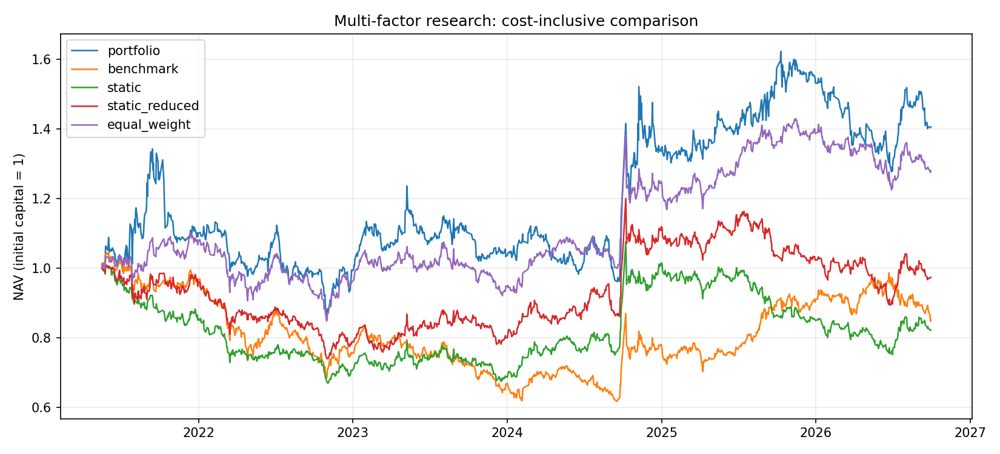

# A-share Multi-Factor Research

一个用于研究复现的 Python 多因子项目：从 BaoStock 数据快照、交易日历和因子构建，到信息可用时间、现金持仓回测、对照实验和风险检验。

**项目采用可审计的研究流程。** 当前仍使用小规模、当前成分股样本；结果不代表无偏的市场实证或实盘业绩。代码包含中文解释，Windows / Anaconda / PyCharm 均可运行。方法与信息时点见 `docs/METHODOLOGY.md`。

## 先运行

建议建立独立环境，避免 `(base)` 与 PyCharm 解释器不一致：

```powershell
conda create -n quant-research python=3.12 -y
conda activate quant-research
python -m pip install -r requirements-tested.txt
python -m unittest discover -s tests -v
```

仓库不包含原始行情缓存。克隆后可先运行确定性合成演示：

```powershell
python scripts/run_all.py --demo
```

合成演示数据在 `data/demo/`，输出在 `outputs/demo/`，不会覆盖真实数据；合成结果不能写作策略业绩。

需要重新下载真实行情时：

```powershell
python scripts/run_all.py --limit 30 --start 2021-01-01 --end 2026-10-06 --experiments
```

默认在线运行的结束日期取运行当天；需要精确复现请显式指定日期并保留快照。BaoStock 连接受远端服务和网络环境影响。验证记录包含离线真实快照与合成全流程；远端下载未在该验证环境执行。

在 PyCharm 中将项目解释器设为 `quant-research`，工作目录设为包含 `config.py` 的项目根目录。可用 `python -c "import sys; print(sys.executable)"` 确认解释器。

## 研究设计

| 项目 | 实现约定 |
|---|---|
| 数据 | BaoStock 日线；股票前复权、沪深 300 指数；当前成分优先列表 |
| 日历 | 以所选区间的指数行情日期作为统一市场交易日历 |
| 因子 | 11 个价量因子；MAD 去极值、横截面 Z-score |
| 主标签 | T+1 开盘到 T+H+1 开盘，H=5；另保留收盘到收盘标签 |
| IC 时点 | 原始 IC 归属 T；在 T+H+1 开盘后成熟，供当天收盘信号使用 |
| 权重 | 60 日滚动历史可用 ICIR，至少 20 个有效 IC；原始 ICIR 截断至 ±3，再按绝对值归一化 |
| 预热 | 全部 11 个权重可用，个股全部 11 个标准化因子有效后才参与动态评分 |
| 交易 | T 收盘选股，下一市场交易日开盘成交；每 5 个市场交易日调仓 |
| 组合 | Top 5，目标等权；实际权重随价格漂移，不每天重置 |
| 费用 | 单边 10bp，按实际买卖成交额扣除；先卖后买，买单受现金约束 |
| 不可成交 | 冻结无法卖出的仓位；无法买入保留现金；未成交单取消，下次计划调仓重算 |
| 开盘约束 | 无有效开盘/停牌禁止交易；按开盘与前收盘比率近似限制涨停买入、跌停卖出 |
| 对照 | 沪深 300、同日历同可选样本等权、11 因子静态组合、6 因子静态去重组合 |
| 风险 | 前一日及更早收益预测当日 VaR；95%/99% VaR、ES、Kupiec POF、历史最差日 |

完整公式、收益记账边界和数据缺失语义见 [方法说明](docs/METHODOLOGY.md)。

## 历史快照的示例结果

数据覆盖 2021-01-04 至 2026-09-30，30 只股票。统一预热后比较区间为 **2021-05-17 至 2026-09-30**。以下均为单边 10bp 的研究回测；指数不计交易费用。

| 策略 | 累计收益 | 年化收益 | Sharpe（rf=0） | 最大回撤 |
|---|---:|---:|---:|---:|
| 动态 ICIR · Top 5 | 40.61% | 6.79% | 0.390 | -35.50% |
| 同股票池等权 | 27.98% | 4.87% | 0.366 | -23.00% |
| 静态 11 因子 | -17.73% | -3.69% | -0.142 | -33.39% |
| 静态 6 因子 | -2.61% | -0.51% | 0.059 | -26.65% |
| 沪深 300 | -14.83% | -3.05% | -0.065 | -40.94% |



动态组合虽然累计收益高于股票池等权，但回撤更大；2025 年以后分段收益约 4.58%，低于同期指数约 9.03%。单边费用从 0 增至 20bp 时，动态组合累计收益由约 74.99% 降至 13.01%，说明成本非常重要。这些数字来自固定参数实验，不把敏感性表里表现最好的参数自动选为“最优策略”。详细结果见 [验证与研究结果](reports/VALIDATION.md)。

## 项目结构

```text
config.py                       统一研究参数与静态因子方向
main.py                         离线研究、对照实验与报表
src/dataset.py                  快照校验、日历、缺失价格、开盘限制
src/data_provider.py            BaoStock 登录、查询和原始清洗
src/factors.py                  11 个因子与 RSI 边界处理
src/preprocess.py               MAD 与 Z-score 的缺失值语义
src/factor_research.py          标签、原始/可用 IC、权重、分组及 HAC 统计
src/portfolio.py                现金、份额、成交和每日资产守恒
src/performance.py              统一起点、标准 Sharpe、分段表现
src/risk.py                     事前 VaR、ES、Kupiec
scripts/                       下载、面板、合成数据、全流程及源码打包
tests/                          回归测试
docs/                          方法、实现边界与输出字段说明
reports/                       可提交 Git 的小体积验证报告与示例图表
data/                          本地行情和处理结果，默认不提交 Git
outputs/                       可再生的大体积审计输出，默认不提交 Git
```

模块依赖顺序为 `dataset → factors → preprocess → factor_research → portfolio → performance/risk → main`。

## 常用命令

```powershell
# 只重算现有 processed 数据，不下载、不重建面板
python main.py --experiments

# 离线裁剪已有快照范围；区间必须位于快照查询范围内
python scripts/run_all.py --offline --start 2022-01-01 --end 2025-12-31 --limit 15

# 修改 BLOCK_LIMIT_OPEN 等面板配置后重新构建
python scripts/build_panel.py

# 检查 BaoStock 连接
python scripts/test_connection.py

# 生成不带行情、大输出、虚拟环境的 GitHub 源码 ZIP
python scripts/package_source.py
```

`--start` 同时也是本次因子预热数据的开始日期，不是单独的绩效起点。若希望从某年开始比较但仍用之前数据预热，应保留完整历史并查看分段报表。

## 输出与可追溯性

`outputs/` 包含原始/可用 IC、逐股票标签成熟日、动态权重、最新评分、目标持仓、每日真实持仓、逐笔成交、受阻订单、风险预测、绩效及敏感性表。`run_manifest.json` 保存参数、依赖版本和数据/源码 SHA-256，便于定位结果属于哪次运行。

运行会覆盖同目录输出；不同实验可用 `--output-dir outputs/experiment_name` 隔离。若手工修改数据导致校验和不符，应重新构建合法快照，不要删掉校验逻辑绕过检查。

## 已知限制

1. 使用当前成分股和手工优先样本，存在生存者偏差、选择偏差；未实现历史成分股、行业/市值中性化。
2. 样本中缺失记录标记为 `unknown_missing`，无法仅凭现有文件证明每一行缺失都是停牌；没有用前向填充伪造可成交价。
3. 模拟持仓是可分割的复权价格单位；未实现整数手数、完整除权分红现金账本、冲击成本、容量和订单簿撮合。
4. 开盘涨跌停阈值是保守近似，未穷尽 IPO/特殊处理/历史板块规则。它只使用开盘时可知价格，不用当天高低收盘判断是否买得到。
5. 股票复权收益和指数价格收益的分红口径可能不同，不能视为严格的总回报基准对比。
6. 2021—2023 / 2024 / 2025 以后是回顾性时间分段。历史数据已经被查看，不称为完全未见的样本外；固定代码后新增未来数据才可用于真正前瞻跟踪。
7. HAC p 值为渐近近似，未处理多重检验；Kupiec 只检验覆盖率，不检验突破独立性；末尾 250 日的 99% ES 只有很少尾部样本。

## 自动化测试与许可

.gitignore 默认排除行情缓存和大体积输出。仓库提供 `.gitignore`、合成演示、自动化测试工作流和代码 MIT 许可证。推送后可在 Actions 查看测试结果；现有本地验证不等于已通过 GitHub Windows/Linux 矩阵。

代码许可见 [LICENSE](LICENSE)。第三方行情数据不因代码许可证而获得再分发授权，默认不上传原始行情。
